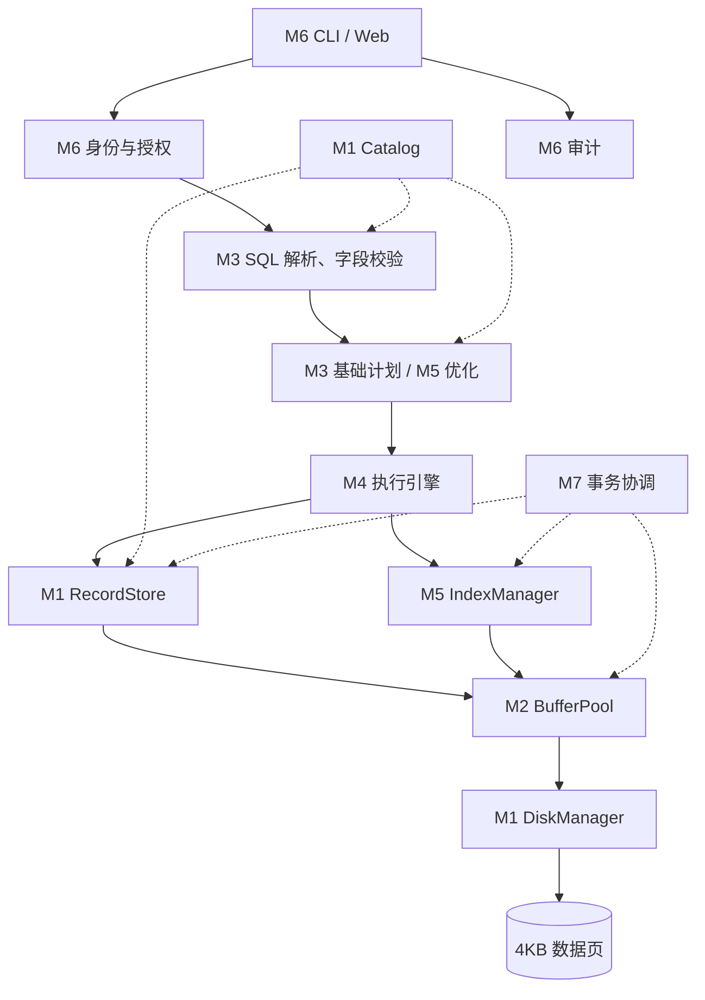

# 模块接口与存储设计

> 历史 M1/M2 设计。新版协作统一使用 `edudb.contracts` 与 `StorageService`；以下旧接口不再作为 B/C/D 接入入口。见 [新版 A 接入说明](module_a_contract.md)。

## 1. 目标调用关系

以下是最终目标架构，当前 M1/M2 已实现。元数据和权限参与多个阶段；索引属于存储访问路径，优化器决定是否使用它。



这是依赖关系图，具体安全检查和审计还需要通过未来的统一请求入口落实。索引页类型和格式属于 M5 的后续设计，不能直接将当前记录页当成索引节点。

## 2. 已实现的 M1 接口

| 接口 | 输入 | 返回或行为 |
| --- | --- | --- |
| Catalog.create_table | TableSchema | 持久化表结构；重复表名报错 |
| Catalog.table / tables | 表名 / 无 | 不可变表结构 / 表结构元组 |
| DiskManager.read_page | 表名、page_id | 独立的 Page 副本；缺页、坏页报错 |
| DiskManager.write_page | 表名、Page | 检查格式和大小后完整替换单个页文件 |
| DiskManager.page_ids | 表名 | 对照持久化分配清单验证已分配页；中间页、尾页或表目录丢失报错 |
| DiskManager.migrate_legacy | M1 数据目录 | 校验已有页后增加清单，保持页字节不变；已有清单时不覆盖 |
| RecordStore.insert | 表名、字段值字典 | RecordId，格式 page_id:slot_id |
| RecordStore.fetch / scan | 表名、RID / 表名 | Record / Record 迭代器 |
| RecordStore.update | 表名、RID、赋值字典 | 原位置更新；检查类型和主键；页放不下则失败 |
| RecordStore.delete | 表名、RID | 将槽标记为空，其他记录的 RID 不变 |

`RecordStore.create_table` 是 Catalog 的组合入口。名字统一为小写 ASCII 标识符。值支持 INT（有符号 64 位）、有限 FLOAT、TEXT、BOOL 和允许为空的字段；主键禁止 NULL。INT 不接受 Python 的 bool 或浮点数隐式截断。

`RecordStore` 只依赖 `PageIO` 协议，不绑定磁盘实现；M2 已通过 `RecordStore(catalog, pool)` 接入。PageIO 读取提供独立副本，显式 write_page 才接受修改。缓冲写入后必须 flush/close 才能保证数据已交给磁盘层。

Catalog 当前直接写元数据文件，不经过数据页缓冲池。未来实验必须说明元数据 I/O 是否单独统计。

## 3. 数据页格式

每个文件固定 4096 字节，路径为 `data/<table>/<8位page_id>.page`。

| 字节偏移 | 长度 | 内容 |
| --- | --- | --- |
| 0 | 4 | 魔数 EDBP |
| 4 | 1 | 格式版本，目前为 1 |
| 5 | 3 | 保留，必须为零 |
| 8 | 4 | 页号，无符号大端整数 |
| 12 | 4 | 有效载荷字节数 |
| 16 | 4 | 有效载荷 CRC32 |
| 20 | 最多 4076 | UTF-8 JSON 槽数组 |
| 剩余部分 | 不定 | 零填充 |

记录大小按 UTF-8 字节计算。槽数组中的 null 表示已删除记录；存活记录是字段值对象。RID 是表内标识，必须与表名一起使用。插入仅追加，不复用已删除槽；更新不搬移记录。暂不支持超大记录、溢出页和空间整理。

采用临时文件写入、flush/fsync 后 replace 的方式更新单个文件；写入异常时清理自己的临时文件。该机制不保证跨页、跨元数据的事务原子性，也没有承诺进程崩溃或断电后的完整数据库恢复。

## 4. 已实现的 M2 接口

| 接口 | 行为 |
| --- | --- |
| BufferPool(disk, capacity=16) | 容量按页计；每实例独占数据库写路径，顺序调用 |
| read_page / write_page / page_ids | 实现 PageIO；读写隔离可变对象；新增脏页立即可见 |
| flush | 按表及页号刷脏页，保持缓存和 LRU 顺序；成功写回的页变干净 |
| clear | flush 成功后清空缓存；失败时不清空，保留待重试页 |
| close / with | flush 并释放缓存；关闭失败仍可使用；重复 close 无副作用 |
| reset_metrics | 只重置计数，不清缓存、不刷脏页 |
| snapshot_metrics | 返回独立指标字典，包含计数、命中率和当前缓存/脏页数 |
| cached_keys / dirty_keys | 不可变页键快照；缓存键按照 LRU -> MRU 排列 |

实现用 OrderedDict 维护 LRU。读命中或接受写入后移到末尾，满时淘汰首项。淘汰脏页时先写回，再移除；失败保留该帧。缓存里的新页可能乱序成为 LRU，因此先写回该页之前尚未持久化的新页，保持连续分配。

flush 不是多页事务。部分页成功、后续页失败时，成功页保持干净，未写回页保持脏状态；重试仅写脏页。`with` 即使在代码块抛出异常时也会尝试关闭并写回已接受的修改，不提供事务回滚。详细指标定义见 [A 模块交接](module_a.md)。

## 5. 分配清单与兼容

存储目录格式 v2 新增根目录 `storage.json`，记录格式名、版本号和各表已持久化页数。数据页仍使用第 3 节的 v1 编码。DiskManager 检查清单与页文件集合一致，新页必须顺序追加。

新页完整写入后再更新清单；清单保存异常时删除本次未登记的新页，原有页不动，缓冲副本仍可重试。两个文件并非原子提交：中途崩溃或补偿删除失败可能留下未登记页，系统检测并报错，需要人工恢复或未来 M7 的恢复机制。

无清单但已有页文件的 M1 数据不会静默升级。显式 `migrate-storage` 校验现有元数据、页编码、页号连续性和主键后写清单，不修改原页。升级不能判断升级之前是否已丢尾页或整个表目录，使用者需确认原目录完整。清单自身丢失、删除整个数据库等情况不提供自动恢复。

## 6. 后续模块应遵守的边界

| 模块 | 输入输出约定 | 边界与责任 |
| --- | --- | --- |
| M3 | SQL -> 带类型的语法树 -> 字段已绑定的计划 | 字符串字面量与列引用分开建模；执行前拒绝不存在或歧义字段 |
| M4 | PlanNode -> 列信息、行、指标 | 通过 RecordStore/IndexManager 访问记录；空结果仍有列定义；协调写语句一致性 |
| M5 | 键值 -> RID；基础计划 -> 优化计划 | 索引不直接变更表记录；优化变换保留查询语义；更新索引和数据由执行层协调 |
| M6 | 已认证用户、请求 -> 响应与审计 | 认证身份不由浏览器任意指定；授权覆盖实际 API；界面展示结构化计划 |
| M7 | 事务上下文 -> 数据、目录、索引的一致状态 | 先实现受限单写事务；会话归属明确；审计不随数据回滚；未实现 WAL 时明确限制 |

未来 PlanNode 应有稳定的 op、children 和算子参数，展示端从结构序列化树，不从缩进文本反向猜树。QueryResult 应区分列元数据、行数据、计划、测量指标和错误；这两个模型由 B/C/D 在 M3 接入前共同确定，当前尚无运行实现。

## 7. 一次查询的验收路径

后续以这条 SQL 做贯穿示例：

```sql
SELECT id, name FROM students WHERE id = 120;
```

M3 证明解析和字段绑定正确；M4 的基线计划经 M2/M1 扫描数据；M5 加入索引后生成 IndexScan；M6 展示结构化计划与结果；M7 在相同实验条件下核对结果并记录数据页读数和耗时。当前 M1/M2 只能通过 Python API 和模块演示访问记录。
