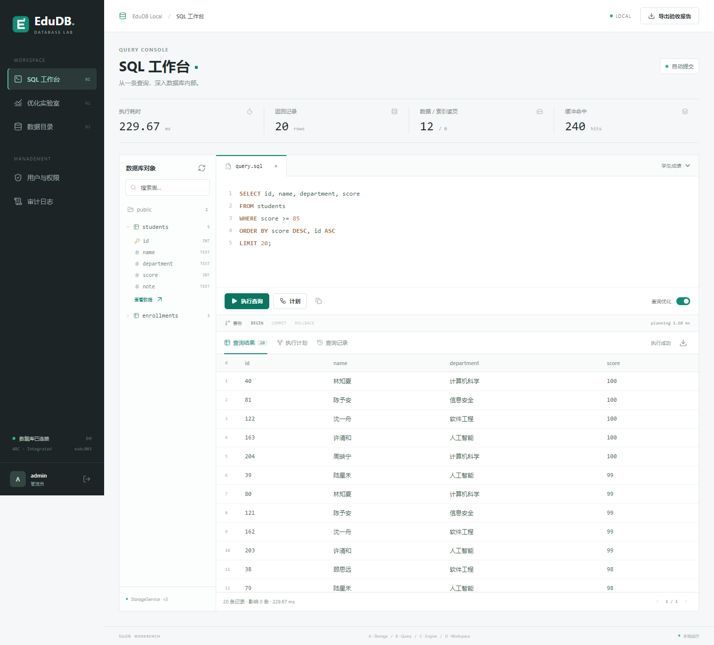
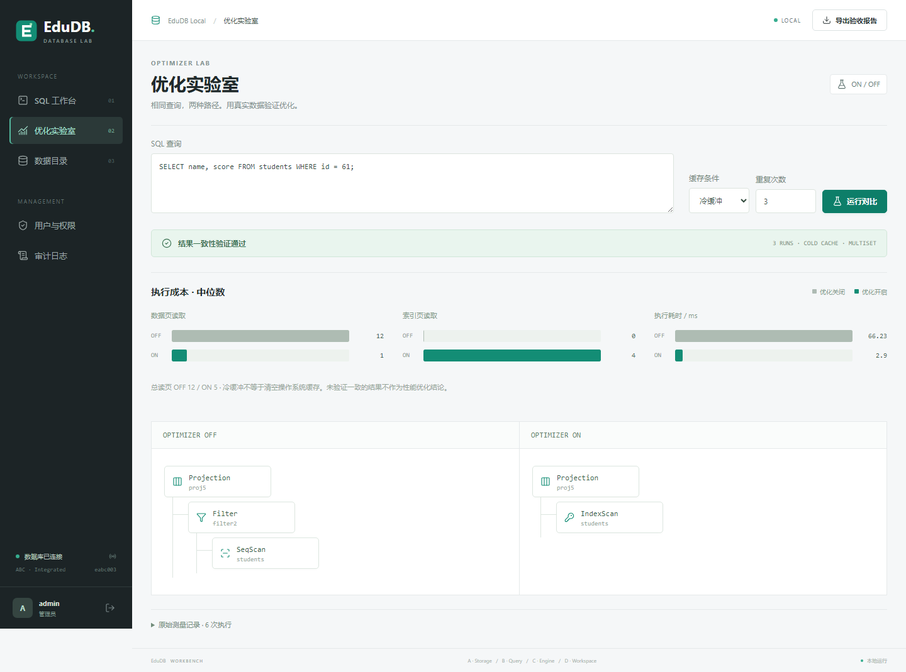

# D 工作台：实现、运行与验收

## 1. 当前交付

本轮新增的 `edudb.web` 是新版 ABC 的 Web 请求入口，不引用 `legacy`。界面为本地静态 HTML/CSS/JavaScript，Python 运行时无第三方依赖；Lucide 图标随仓库分发，许可在 `static/LUCIDE-LICENSE`。页面不依赖 CDN 或外部字体。

| 范围 | 实现 | 关键验证 |
| --- | --- | --- |
| SQL 工作台 | 高亮编辑、例子、表目录、结果分页、CSV、事务按钮 | 真正调用 ABC；失败清空旧结果；空结果、截断和加载状态 |
| 执行计划 | 树结构、算子图标、节点详情、每算子指标 | 来自本次计划和指标，不用静态截图 |
| 优化实验 | SELECT 限定、冷热缓存、交替 ON/OFF、1-7 次、中位数与原始值 | 同一实例独占实验、结果比较、数据/索引/总读页分列 |
| 身份 | 随机初始管理员、加盐 PBKDF2-SHA256、登录限速 | 不默认匿名管理员，不明文存储密码 |
| 会话 | HttpOnly/SameSite Cookie、CSRF、30 分钟空闲/8 小时最长时限 | 退出和过期回滚自己的事务，不能提交别人的事务 |
| 权限 | 管理员/普通成员，按 A 持久表 ID 授予 SELECT/INSERT/UPDATE/DELETE | 编译后执行前检查所有上报权限，包含 JOIN/子查询/EXPLAIN |
| 审计 | 请求和结果事件、SHA-256 链、追加后 fsync | 失败也记录，字符串/数值字面量脱敏，登录不记录密码 |
| 报告 | 自包含 HTML，原始 JSON，测试证据与源文件 SHA256 | 未运行/过期明确标记，不伪造通过状态 |

## 2. 启动

从仓库根目录运行：

```powershell
python -m edudb.web --demo --port 8766
```

浏览器打开终端 URL。首次随机密码只在终端输出一次，账号为 admin；后续启动不会再输出或覆盖密码。默认数据目录 `.edudb_workbench` 被 Git 忽略。也可用 `--db 新目录` 分离演示数据；不要传入旧 ABC CLI 或参考运行时的数据目录。

`--demo` 在空库创建 students（240 行、id 索引）和 enrollments（24 行）；数据库仍通过真实 SQL 与 ABC 写入。已有库不清空。端口被占用时使用 `--port 8767` 或其他空闲端口。只绑定 127.0.0.1，不对局域网或公网提供服务。

初始密码可由环境变量 `EDUDB_ADMIN_PASSWORD` 指定，要求 12-128 字符；只在首次建立管理员时生效。丢失密码时不要覆盖已有数据或改成免登录；本轮未提供忘记密码和在线密码重置流程。管理员可创建额外账户供演示。

## 3. 目录与接口

```text
edudb/web.py                     本地 HTTP、静态文件白名单、Cookie/CSRF/Host 检查
edudb/workbench/service.py       请求生命周期、授权、事务、实验与报告
edudb/workbench/security.py      持久身份、密码摘要、表级授权
edudb/workbench/audit.py         脱敏与审计链
edudb/workbench/evidence.py      实测测试证据生成与指纹校验
edudb/workbench/report.py        转义后的自包含 HTML 报告
edudb/workbench/static/          界面、图标与品牌资源
tests/test_workbench.py          D 单元与 HTTP 测试
tests/web_smoke.cjs              可重复运行的真实浏览器验收
```

成功 API 返回 JSON，失败为 `{error: {code, message, position, transaction_effect}}`。所有业务 API 需登录；POST 除登录外均需 X-CSRF-Token，所有 POST 需正确 Origin 与 application/json。前端从 `/api/state` 获取 CSRF，token 不存 localStorage。

| 路径 | 方法 | 职责 |
| --- | --- | --- |
| /api/login、/api/logout | POST | 登录与退出 |
| /api/state | GET | 当前身份、可读目录、事务、历史和状态 |
| /api/query | POST | sql、optimizer；返回结果、计划、指标 |
| /api/compare | POST | sql、repeats、cache；返回中位数和样本 |
| /api/users | GET/POST | 管理员查看/创建用户 |
| /api/grants | POST | 管理员设置用户某表的完整权限集合 |
| /api/audit | GET | 管理员查看最近 200 条审计 |
| /api/report、/api/report.html | GET | 当前会话报告 JSON/HTML |

普通成员只看到有 SELECT 权限的表；管理员负责 DDL 与授权。改变授权前要求没有活动事务，避免撤销权限后的事务边界混乱。创建账户不自动授予任何表权限。

## 4. 实验与报告口径

COMPARE 仅接受 SELECT，并要求无活动事务。整轮实验持有运行时请求锁，防止数据在两种计划之间被写入。交替 OFF/ON 与 ON/OFF；冷条件每次清 A 缓冲，热条件清缓冲后先预热一次再计量。操作系统缓存不会被清空。

无 ORDER BY 按多重集比较，保留重复行；有 ORDER BY 使用保守的输出序列比较。并列排序键导致的不同排列可能标为未通过，而非断言引擎错误；正式报告需采用唯一排序键。无确定排序的 LIMIT 同样可能不稳定。数据页降低不代表总读页或耗时降低。

规划耗时单独测量 B 编译，执行耗时沿用 C 指标，不包含网络、序列化和 UI。A 后台/目录写回有独立 system_metrics；查询 page_writes 不是整个进程写盘总量。

测试证据生成：

```powershell
python -m edudb.workbench.evidence
python -m edudb.web --demo --test-evidence .test_tmp/workbench/test-evidence.json
```

浏览器右上角导出 HTML，内含可展开原始 JSON，可打印。没有证据显示 not_run；源文件变化显示 stale。报告不导出查询结果行、密码、SQL 字面量或计划中的字面量，只保留计划结构、指纹与真实指标。测试证据是本地生成文件，不是第三方签名认证。

## 5. 验收步骤

本轮实测：Python 全量 **226 项通过**（原 ABC 211 项 + D 15 项）；Playwright + Edge 的 390/768/1440 三种宽度验收通过，页面脚本错误为 0，各视图无页面级横向溢出。真实浏览器执行了查询、节点详情、错误清空旧结果、事务回滚、实验、报告下载、创建用户、授权、审计、退出及越权拒绝。

实际页面截图：





1. 运行 `python -m unittest discover -s tests -q`，核对真实通过数。
2. 启动 Web，未登录直接请求业务 API 应返回 401。
3. 登录管理员，执行默认查询，检查 20 行结果、指标和可点击计划。
4. 开始事务，更新 students 的 score，再回滚，查询确认恢复。
5. 优化实验使用 `SELECT name, score FROM students WHERE id=61`，检查 ON/OFF 结果一致、图表及逐次记录，不强制速度胜负。
6. 创建普通成员，只给 students 的 SELECT；新会话查询成功，DELETE、访问 enrollments、管理用户、审计均拒绝。
7. 检查审计成功与拒绝事件；输入语法错误后，结果区不得保留旧表格。
8. 导出报告核对测试证据和实验；退出登录后清除页面旧数据，未提交事务回滚。
9. 检查 390/768/1440 宽度下的各视图，不出现页面横向溢出。

可选浏览器自动验收需要 Node、Playwright 与已安装的 Edge（Windows）或 Chromium（其他系统）：`node tests/web_smoke.cjs`。脚本启动自己的临时服务器和临时数据库，生成截图与报告到 `.test_tmp/web-acceptance-*`，不依赖你的日常账户。Python 项目正常运行不要求这些 QA 依赖。

## 6. 安全与交付限制

这是本地课程工作台，不声称生产安全认证或国奖保证。无 TLS、不允许远程绑定；Cookie 因本地 HTTP 不设置 Secure。账户/审计文件需操作系统文件权限保护；审计哈希链能检测意外修改，不抵抗拥有文件写权限的人重算全链或截断尾部。

认证与权限在 Web 服务层生效，拥有本机目录/代码执行权限的人仍能直接调用 ABC；这不是数据库 OS 级安全边界。结果展示上限 500 行，底层仍会在执行器内物化结果并受原执行器内存约束；未实现服务器游标、大规模查询取消或硬时限。

当前 UI 的查询历史和实验记录属于登录会话，退出后清除；持久审计保留。尚无账户禁用、密码恢复、审计轮转和长时间运行的容量管理。A 单页目录与单写事务限制仍然存在。

组员仍需复核自己的模块、填写实际贡献、完成课堂环境验收与答辩材料。开发完成和测试通过不是竞赛获奖结论。
