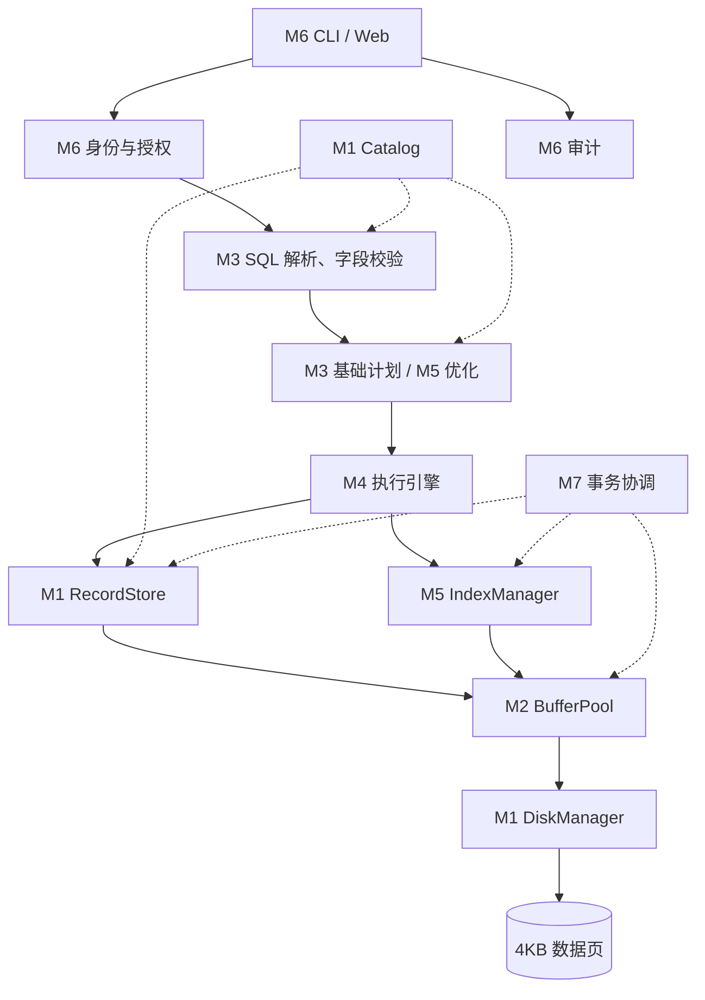

# 模块接口与存储设计

## 1. 目标调用关系

以下是最终目标架构，当前仅 M1 已实现。元数据和权限参与多个阶段；索引属于存储访问路径，优化器决定是否使用它。



这是依赖关系图，具体安全检查和审计还需要通过未来的统一请求入口落实。索引页类型和格式属于 M5 的后续设计，不能直接将当前记录页当成索引节点。

## 2. 已实现的 M1 接口

| 接口 | 输入 | 返回或行为 |
| --- | --- | --- |
| Catalog.create_table | TableSchema | 持久化表结构；重复表名报错 |
| Catalog.table / tables | 表名 / 无 | 不可变表结构 / 表结构元组 |
| DiskManager.read_page | 表名、page_id | 独立的 Page 副本；缺页、坏页报错 |
| DiskManager.write_page | 表名、Page | 检查格式和大小后完整替换单个页文件 |
| DiskManager.page_ids | 表名 | 已存在页号的有序元组；中间断档报错 |
| RecordStore.insert | 表名、字段值字典 | RecordId，格式 page_id:slot_id |
| RecordStore.fetch / scan | 表名、RID / 表名 | Record / Record 迭代器 |
| RecordStore.update | 表名、RID、赋值字典 | 原位置更新；检查类型和主键；页放不下则失败 |
| RecordStore.delete | 表名、RID | 将槽标记为空，其他记录的 RID 不变 |

`RecordStore.create_table` 是 Catalog 的组合入口。名字统一为小写 ASCII 标识符。值支持 INT（有符号 64 位）、有限 FLOAT、TEXT、BOOL 和允许为空的字段；主键禁止 NULL。INT 不接受 Python 的 bool 或浮点数隐式截断。

`RecordStore` 只依赖 `PageIO` 协议，不绑定磁盘实现；M2 可以通过依赖注入接入。PageIO 的读取必须提供独立副本，调用者修改副本后只有显式 write_page 才影响存储状态。未来缓存页不得直接暴露内部可变字典。

Catalog 当前直接写元数据文件，不经过数据页缓冲池。未来实验必须说明元数据 I/O 是否单独统计。

## 3. 数据页格式

每个文件固定 4096 字节，路径为 `data/<table>/<8位page_id>.page`。

| 字节偏移 | 长度 | 内容 |
| --- | --- | --- |
| 0 | 4 | 魔数 EDBP |
| 4 | 1 | 格式版本，目前为 1 |
| 5 | 3 | 保留，必须为零 |
| 8 | 4 | 页号，无符号大端整数 |
| 12 | 4 | 有效载荷字节数 |
| 16 | 4 | 有效载荷 CRC32 |
| 20 | 最多 4076 | UTF-8 JSON 槽数组 |
| 剩余部分 | 不定 | 零填充 |

记录大小按 UTF-8 字节计算。槽数组中的 null 表示已删除记录；存活记录是字段值对象。RID 是表内标识，必须与表名一起使用。插入仅追加，不复用已删除槽；更新不搬移记录。暂不支持超大记录、溢出页和空间整理。

采用临时文件写入、flush/fsync 后 replace 的方式更新单个文件；写入异常时清理自己的临时文件。该机制不保证跨页、跨元数据的事务原子性，也没有承诺进程崩溃或断电后的完整数据库恢复。

## 4. 后续模块应遵守的边界

| 模块 | 输入输出约定 | 边界与责任 |
| --- | --- | --- |
| M2 | 实现 PageIO，另提供 flush 和指标快照 | 管理缓存副本、脏页和失败后的可重试状态；不解析 SQL |
| M3 | SQL -> 带类型的语法树 -> 字段已绑定的计划 | 字符串字面量与列引用分开建模；执行前拒绝不存在或歧义字段 |
| M4 | PlanNode -> 列信息、行、指标 | 通过 RecordStore/IndexManager 访问记录；空结果仍有列定义；协调写语句一致性 |
| M5 | 键值 -> RID；基础计划 -> 优化计划 | 索引不直接变更表记录；优化变换保留查询语义；更新索引和数据由执行层协调 |
| M6 | 已认证用户、请求 -> 响应与审计 | 认证身份不由浏览器任意指定；授权覆盖实际 API；界面展示结构化计划 |
| M7 | 事务上下文 -> 数据、目录、索引的一致状态 | 先实现受限单写事务；会话归属明确；审计不随数据回滚；未实现 WAL 时明确限制 |

未来 PlanNode 应有稳定的 op、children 和算子参数，展示端从结构序列化树，不从缩进文本反向猜树。QueryResult 应区分列元数据、行数据、计划、测量指标和错误；这两个模型由 B/C/D 在 M3 接入前共同确定，当前尚无运行实现。

## 5. 一次查询的验收路径

后续以这条 SQL 做贯穿示例：

```sql
SELECT id, name FROM students WHERE id = 120;
```

M3 证明解析和字段绑定正确；M4 的基线计划经 M2/M1 扫描数据；M5 加入索引后生成 IndexScan；M6 展示结构化计划与结果；M7 在相同实验条件下核对结果并记录数据页读数和耗时。当前 M1 演示只能通过 Python API 访问这些记录。
